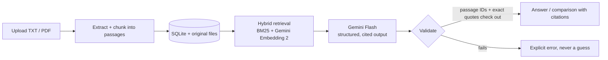

# Folio

### Catch up on a developing story, with receipts.

Folio turns a pile of dated public reports into **cited answers** and **trustworthy before/after comparisons**. Every claim links back to the exact quote, page, date, and publisher it came from. If the evidence isn't there, Folio says so instead of guessing.

| File | Link | 
| --- | --- | 
| Slides | [Link](https://drive.google.com/file/d/1N3WFr5wsaiRdHwgB7LNKq7YF01UXPoFQ/view?usp=drive_link) | 
| Business Plan | [Link](https://drive.google.com/file/d/14vPPITAEuaf6VaYoBpopxnMhoU9mzAAj/view?usp=drive_link) | 
| Demo Video | [Link](https://drive.google.com/file/d/17Q3dbk6T3XcBNkhT6EgEn_o5A6-PK21O/view?usp=drive_link) |

---

## Why Folio

Stories like disasters, court cases, and financial events change by the day. Reports pile up, versions contradict each other, and summaries from AI tools often cannot show where a statement came from.

Folio is built around one rule: **no claim without evidence you can inspect.**

## What it does

- **Upload dated reports.** UTF-8 TXT or text-based PDF, up to 10 MiB, with a report date and optional publisher URL.
- **Ask questions across selected reports.** Answers are built only from validated, cited claims.
- **Compare two versions of a report.** Pick an older and a newer report. Every asserted change must be supported by passages from **both** versions.
- **Inspect any citation.** Citation chips open the stored passage with the source file, date, page, the exact highlighted quote, and a link to the publisher.
- **Fail honestly.** Unsupported questions return an explicit *insufficient evidence* response, and provider failures show a real error. There are no fixtures, sample mode, or fallback answers.

## How it works



**Trust by design**

1. Retrieval runs **independently per selected report**, then interleaves up to six passages so no single report dominates.
2. The model must return passage IDs and exact quotes.
3. The backend **validates every ID and quote** against stored text. Citation metadata comes from storage, never from the model.
4. Invalid output gets at most one repair attempt, then a clear error.

## Tech stack

| Layer | Choice |
| --- | --- |
| Frontend | Next.js (App Router), in `web/` |
| Backend | FastAPI (Python 3.12+), in `backend/` |
| Storage | Local SQLite and original files under `backend/data/` |
| Retrieval | BM25 + Gemini Embedding 2 (768-dim), fused with reciprocal rank fusion |
| Generation | Gemini Flash (default `gemini-3.8-flash`) with `low` thinking level |
| Testing | pytest, ESLint, TypeScript, Playwright (real Chromium, no mocks) |

Deliberately **not** included: Supabase, authentication, crawling, OCR, or any extra infrastructure.

---

## Quick start

Requires Node.js 20.9+ and Python 3.12+. Run from the repo root.

```sh
npm ci
python3 -m venv .venv
. .venv/bin/activate
python -m pip install -r backend/requirements-dev.txt
cp .env.example backend/.env      # add GEMINI_API_KEY here
```

Create `web/.env.local` containing only:

```dotenv
NEXT_PUBLIC_API_BASE_URL=http://localhost:8000
```

Start two terminals:

```sh
# Terminal 1, repo root
npm run dev
```

```sh
# Terminal 2, repo root, virtualenv activated
cd backend
python -m uvicorn app.main:app --reload --host 127.0.0.1 --port 8000
```

| What | Where |
| --- | --- |
| App | <http://localhost:3000> |
| Backend health | <http://localhost:8000/health> |
| Interactive API docs | <http://localhost:8000/docs> |
| OpenAPI schema | <http://localhost:8000/openapi.json> |

> **Keys stay on the backend.** Put secrets only in `backend/.env`. Never copy them to `web/` or use a `NEXT_PUBLIC_` prefix. Setup and health checks need no key.

### Configuration

| Variable | Purpose | Default |
| --- | --- | --- |
| `GEMINI_API_KEY` (or `GOOGLE_API_KEY`) | Provider credential, backend only | none |
| `GEMINI_MODEL` | Generation model | `gemini-3.8-flash` |
| `GEMINI_TIMEOUT_SECONDS` | Generation timeout | `60` (max 120) |
| `GEMINI_MAX_OUTPUT_TOKENS` | Output cap | `4096` (max 8192) |
| `GEMINI_EMBEDDING_TIMEOUT_SECONDS` | Per-call embedding timeout | `8` (max 20) |
| `FOLIO_RETRIEVAL_MODE` | `hybrid` or `bm25` (keyword only) | `hybrid` |
| `FOLIO_MAX_UPLOAD_BYTES` | Lower the 10 MiB upload cap | 10 MiB |
| `FOLIO_CORS_ORIGINS` | Comma-separated allowed origins | `http://localhost:3000` |

Shell variables override `backend/.env`. Storage paths are relative to `backend/`. Tables and the upload directory are created on the first storage request.

---

## API v1

| Operation | Purpose |
| --- | --- |
| `GET /health` | Process liveness |
| `GET /documents` | List uploaded documents |
| `POST /documents` | Upload PDF/TXT with report date and metadata |
| `POST /ask` | Retrieve evidence and generate a cited answer |
| `POST /compare` | Compare explicitly selected older/newer reports |
| `GET /passages/{id}` | Return the exact supporting passage |

```sh
# Upload a public report (omit source_url if unknown)
curl -X POST http://localhost:8000/documents \
  -F 'file=@report.txt;type=text/plain' \
  -F 'title=Example report' \
  -F 'report_date=2026-10-20' \
  -F 'source_url=https://example.org/report'

curl http://localhost:8000/documents
```

```json
POST /ask
{"question": "How many shelters opened?", "doc_ids": ["doc_ID"]}
```

- Invalid IDs, quotes, or model output return **502**. Provider timeouts return **504**.
- Empty retrieval, or a model finding of insufficient evidence, returns **200** with `status: "insufficient_evidence"` and no claims.
- Provider billing/quota, credential, and rate-limit failures return distinct safe messages. Logs never contain provider bodies, prompts, or keys.

Full request/response shapes, identifiers, dates, and citation rules are in the [API contract](docs/api-contract.md).

---

## Retrieval details

**Hybrid by default.** Each passage is embedded independently with `gemini-embedding-2`. Vectors are cached in SQLite (`passage_embeddings`, keyed by passage ID, model, dimension, and prompt version, with a content hash to prevent stale reuse). Semantic and BM25 rankings are fused per selected report with reciprocal rank fusion (`1 / (60 + rank)`), using up to 20 candidates from each.

**Resilient.** Missing credentials, timeouts, provider errors, malformed vectors, or cache failures fall back to BM25. A failed embedding never fails an upload. Missing vectors are backfilled on retrieval in batches of at most 32. Restarts reuse saved vectors, and the in-memory BM25 index rebuilds from stored passages.

**Measured latency** (live API, small synthetic corpus, excluding answer generation):

| Mode | Latency |
| --- | --- |
| BM25 | median 0.17 ms |
| Hybrid, cold (includes embedding backfill) | 1,898 ms |
| Hybrid, cached | median 1,025 ms |

This is a small-corpus sanity check, not a production benchmark. Embedding API time dominates the hybrid results.

---

## Verification

Everything is tested against the real stack. **No requests are intercepted, mocked, or fulfilled with fixtures.**

```sh
npm run lint
npm run typecheck
npm run build
cd backend && python -m pytest
```

**Latest results:**

- **Full API check:** all five sample documents uploaded and indexed (194 passages). Error paths returned the expected 404/422/415. Two real cited answers and one insufficient-evidence response were produced, and every citation resolved to stored text with matching metadata and exact quotes.
- **Real browser checks (Playwright + Chromium):** 3 of 3 pass. Uploads persist, insufficient evidence is explicit, upload and connection errors stay visible, and a real Gemini answer opens its citation on **desktop and mobile** with matching metadata, an exact highlighted quote, and a publisher link.

<details>
<summary><strong>Reproduce the checks</strong></summary>

**Browser checks** (stop anything already running on ports 3000 and 8000 first):

```sh
npx playwright install chromium
npm run test:live --workspace @folio/web
```

This starts the production Next.js server and the real FastAPI app with temporary SQLite/files. It uses the root `.venv` on Unix, `eval/.venv` on Windows, or the executable in `FOLIO_TEST_PYTHON`. Rebuild the frontend after changing public API URL settings, since they are bundled at build time. Set `PLAYWRIGHT_CHROMIUM_EXECUTABLE` to use an installed Chrome. Traces and API attachments go to the ignored `web/test-results/`, with the report at `web/test-results/live-report.json`.

**Full API path:**

```sh
cd backend
python -m app.generation.api_smoke
```

Uses temporary storage and the real model client, refuses dependency overrides, and stops on the first generation failure. Only `success: true` in the ignored `backend/data/api-smoke.json` receipt confirms the complete live path.

**Single genuine model request:**

```sh
cd backend
python -m app.generation.smoke
```

Records UTC time, model ID, returned `modelVersion`, response, and elapsed ms in `backend/data/model-smoke.json`. Failed records include a safe `error.reason` (`network_error`, `configuration`, or `output_token_limit`) and the provider HTTP status when available.

</details>

---

## Team and workflow

| Lane | Focus | Files |
| --- | --- | --- |
| W1 | Backend, AI, integration | API, contracts, generation, storage, root config/docs |
| W2 | Ingestion and retrieval | `backend/app/ingestion/`, `backend/app/retrieval/`, lane tests |
| W3 | Frontend and experience | `web/` |
| W4 | Corpus, evaluation, demo | `samples/`, `fixtures/`, `evaluation/`, demo and evaluation docs |

Claim a lane, work on its branch, and commit small tested changes. W1 integrates. Coordinate before touching another lane or the shared contract, and loop in W1 for frontend dependency changes (single root `package-lock.json`).

## Docs

- [Sprint plan](docs/sprint-plan.md): exact file boundaries, handoffs, and checkpoints
- [API contract v1](docs/api-contract.md): shapes, identifiers, dates, and citation rules

## Notes for contributors

- Backend routes get the model via `Depends(get_model_client)` from `app.generation.client` and call `client.generate(prompt)` in a synchronous route.
- `meta.retrieval_mode` keeps its v1 literal `"bm25"` for compatibility. Backend INFO logs report `requested`, `actual`, `fallback`, and retrieval `elapsed_ms` separately.
- Use public sample reports only, and keep keys out of Git and browser code.
